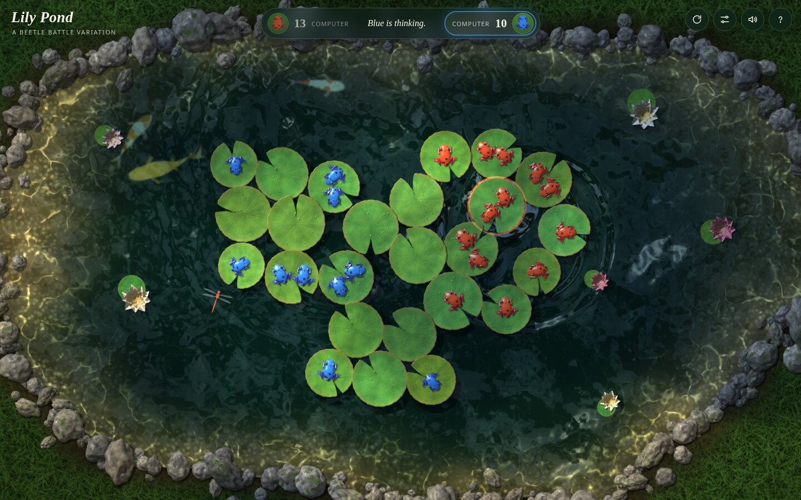

# Beetle Battle
Beetle Battle board game in Python. Refer to "[Beetle Battle manual](manual)" for the manual. 

## Requirements
Be sure to install Python (https://www.python.org/downloads/).

## Execute the script
The script can be run by executing the command:
```
$ python3 app.py
```

## Create executable
The Python script can be packaged into an executable using the ``pyinstaller`` tool (see https://pyinstaller.org). This tool can be installed by executing the following command:
```
$ pip install pyinstaller
```

When the tool is installed, an executable can be created by executing the following command:
```
$ python3 -m PyInstaller "Beetle Battle.spec" 
```

This will create an executable in the `dist` folder. On OS X this is the ``Beetle Battle.app`` package which is an macOS app that can be executed and copied in your applications folder.

## Limited version
A limitited version of a 11x11 2 player version is implemented in [beetle_battle.py](beetle_battle.py).

## HTML version

An HTML/CSS/JavaScipt version of the game was made.

**Click [here](https://htmlpreview.github.io/?https://raw.githubusercontent.com/computerguided/beetle-battle/refs/heads/main/beetle_battle.html) to run the game in your browser.**

## Smart Beetles

An interactive HTML version is avialable in which you can train an algorithm using reinforcement learning and play against it.

**Click [here](https://htmlpreview.github.io/?https://raw.githubusercontent.com/computerguided/beetle-battle/refs/heads/main/beetle_battle_brain.html) to run the game in your browser.**

A detailed explaination of the algorithm can be found [here](https://htmlpreview.github.io/?https://raw.githubusercontent.com/computerguided/beetle-battle/refs/heads/main/beetle_battle_learning_design.html).

## Lily Pond

A variation of the game set in a lily pond, seen from above. The squares are lily pads, the beetles are frogs, and the rules are the same: a pad holds one frog fewer than it has neighbours, a full pad sends one frog leaping to every neighbouring pad, and frogs that land on a pad win over whoever sits there.



**Click [here](https://htmlpreview.github.io/?https://raw.githubusercontent.com/computerguided/beetle-battle/refs/heads/main/lily_pond.html) to run the game in your browser**, or open [lily_pond.html](lily_pond.html) from disk. It needs a browser with WebGL 2.

* **Every pond is different.** The board dimension (3, 5, 7, 9 or 11) sets the size of the pond and gives about _n_&sup2; lily pads, but where they float is random. Pads that touch are neighbours; every pad has 2 to 4 neighbours and all pads form one connected cluster.
* **Computer player** with three levels: _Tadpole_ (often plays at random), _Frog_ (the heuristic of the original computer player, expressed in pad capacities so it works on any pond) and _Bullfrog_ (alpha-beta look-ahead on the same heuristic). Either colour, or both, can be played by the computer.
* **Assets**: the frogs, lily pads, flowers, rocks, koi, dragonflies and grass are modelled procedurally and rendered with Blender; the sounds are made with ElevenLabs; the water (ripples, caustics, reflections) is simulated live in a shader.

Everything lives in [lily_pond](lily_pond):

| Path | Contents |
| --- | --- |
| `src/core.js` | pond generation, rules engine, computer player |
| `src/render.js`, `src/game.js`, `src/main.js` | WebGL renderer, frog behaviour and turn flow, interface |
| `blender/` | Blender scripts that model and render the sprites |
| `assets/` | texture atlases and sounds |
| `tools/` | atlas packer and tests |

To rebuild after a change:
```
$ blender -b -P lily_pond/blender/frog.py -- renders          # only when the models change
$ blender -b -P lily_pond/blender/props.py -- renders
$ python3 lily_pond/tools/pack_assets.py renders               # needs Pillow
$ python3 lily_pond/build.py                                   # writes lily_pond.html
$ node lily_pond/tools/test_core.js                            # checks ponds, rules and players
```

